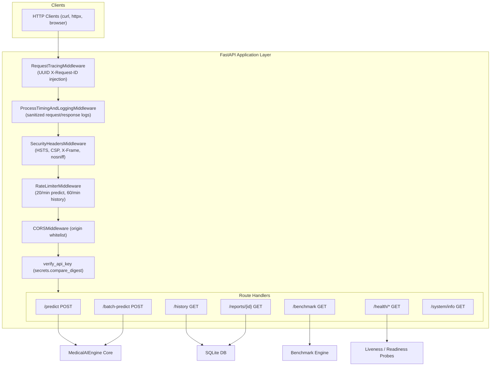
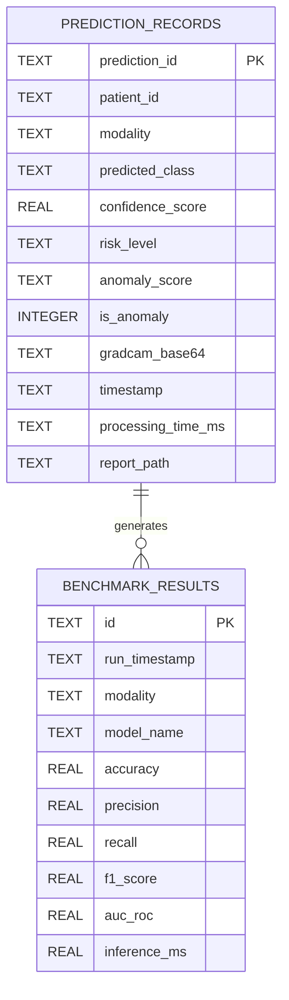
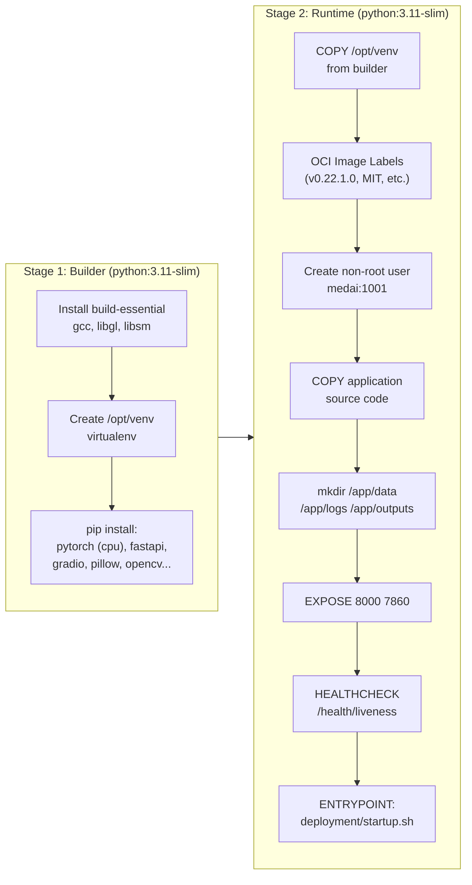
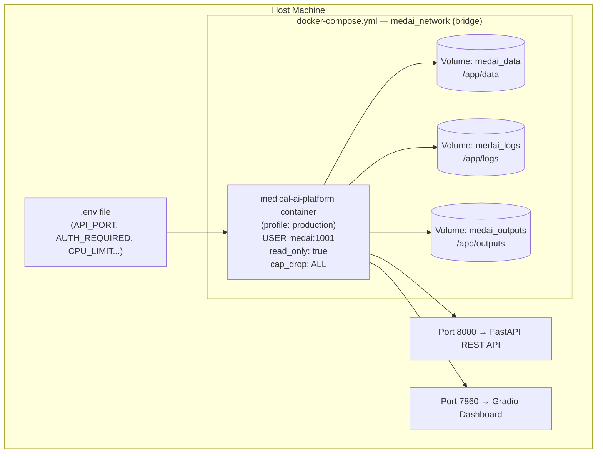

# API, Database & Deployment Architecture Diagrams

---

## 1. REST API Architecture & Middleware Stack

---

## 2. SQLite Database Schema (Entity Relationship Diagram)

---

## 3. Docker Multi-Stage Build Diagram

---

## 4. Docker Compose Service Topology

