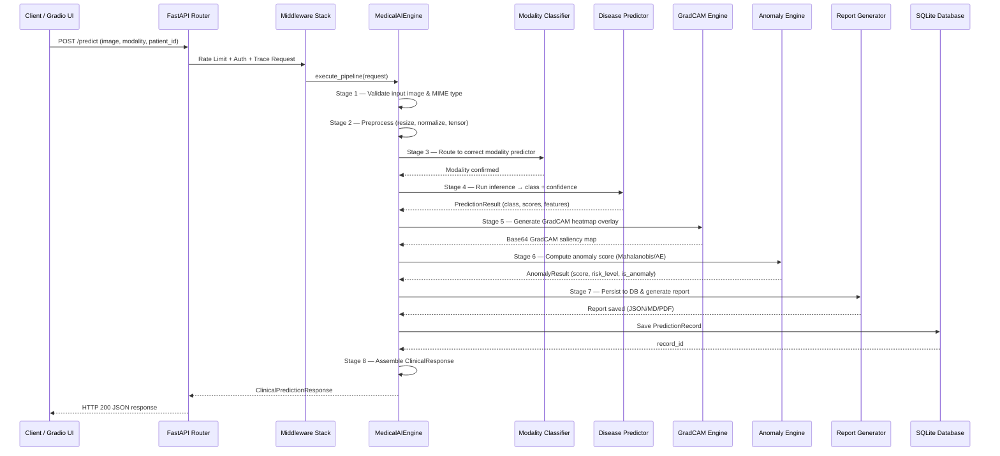
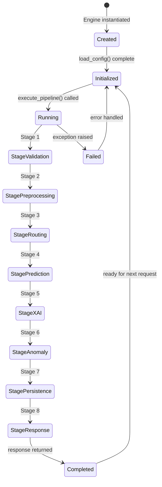
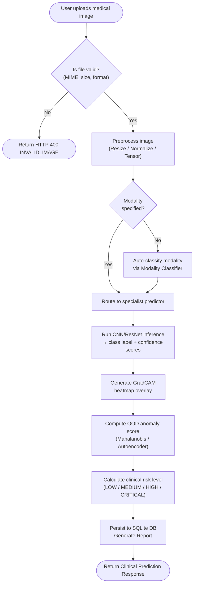

# Prediction Pipeline & Request Lifecycle Diagrams

---

## 1. Prediction Pipeline — Sequence Diagram

---

## 2. Prediction Request Lifecycle — State Machine

---

## 3. Prediction Workflow Flowchart

