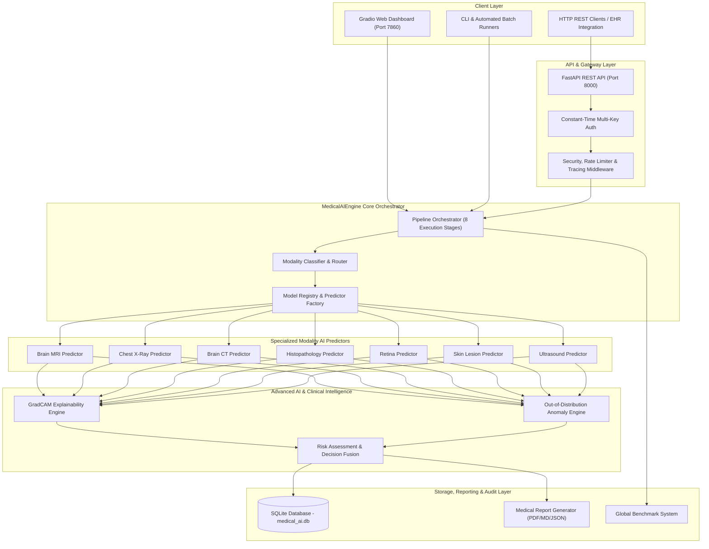

# Architectural Diagrams — Medical AI Platform (`v0.23.0.0`)

This document provides publication-quality Mermaid architectural diagrams for the Medical Image Diagnosis & Anomaly Detection Platform.

---

## 1. Overall System Architecture

---

## 2. MedicalAIEngine Core Architecture

```mermaid
graph LR
    subgraph Core ["MedicalAIEngine Core"]
        INIT["Engine Initialization"] --> CONFIG["Load Global Config"]
        CONFIG --> READY["State: INITIALIZED"]
        READY --> EXEC["execute_pipeline(request)"]
    end

    subgraph Stages ["8 Pipeline Execution Stages"]
        EXEC --> S1["Stage 1: Input Validation"]
        S1 --> S2["Stage 2: Preprocessing"]
        S2 --> S3["Stage 3: Modality Routing"]
        S3 --> S4["Stage 4: Disease Prediction"]
        S4 --> S5["Stage 5: GradCAM XAI Map Generation"]
        S5 --> S6["Stage 6: OOD Anomaly Detection"]
        S6 --> S7["Stage 7: Report & History Persistence"]
        S7 --> S8["Stage 8: Unified Clinical Response Assembly"]
    end

    S8 --> RESP["Clinical Prediction Response"]
```

