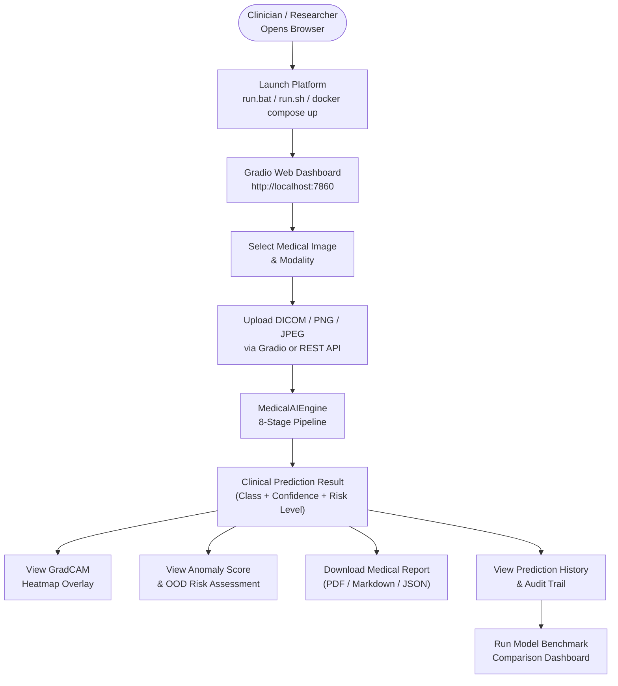
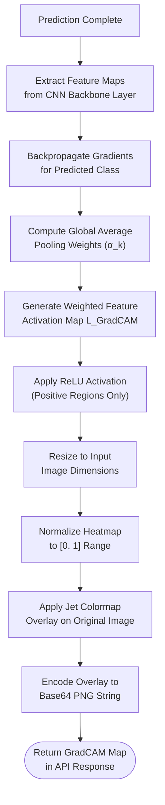
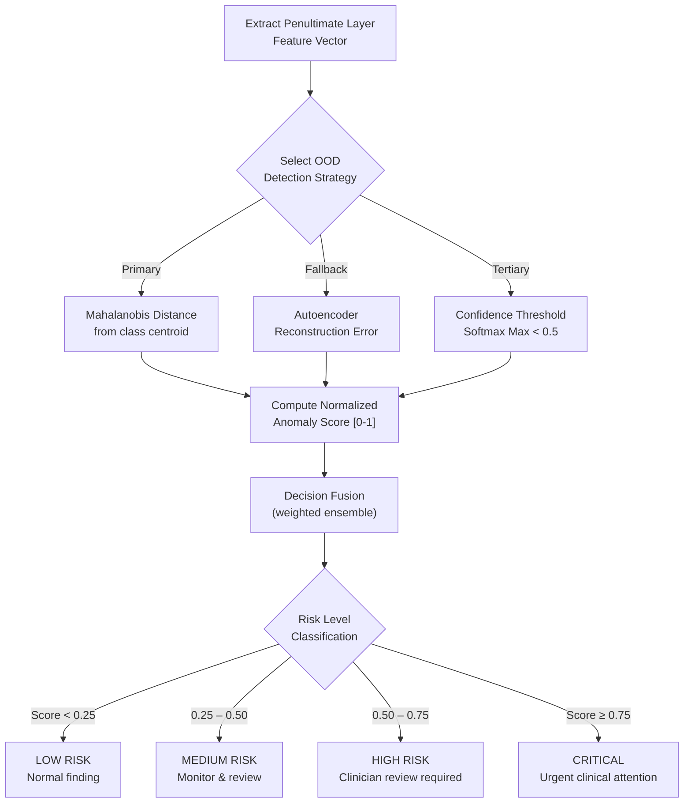
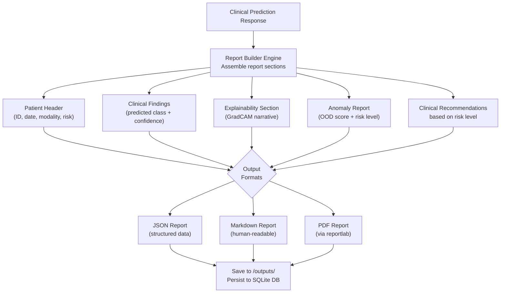
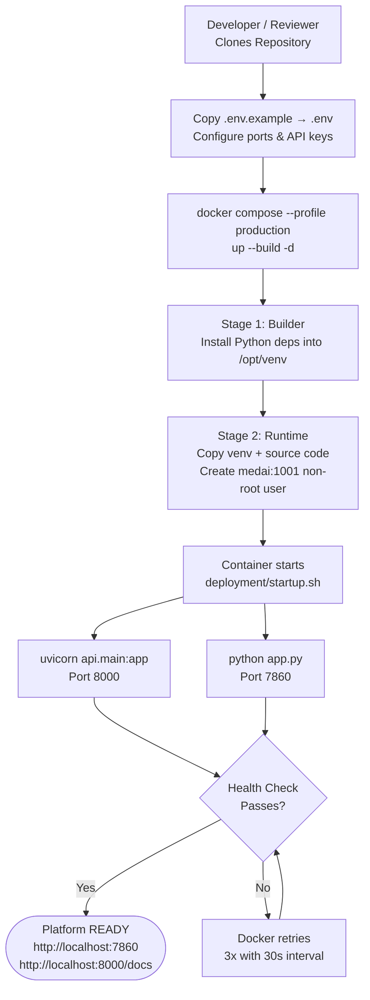

# System Workflows & Flowcharts

---

## 1. End-to-End System Workflow

---

## 2. Explainability (GradCAM XAI) Workflow

---

## 3. Anomaly Detection Workflow

---

## 4. Medical Report Generation Workflow

---

## 5. Deployment Workflow (Docker)

