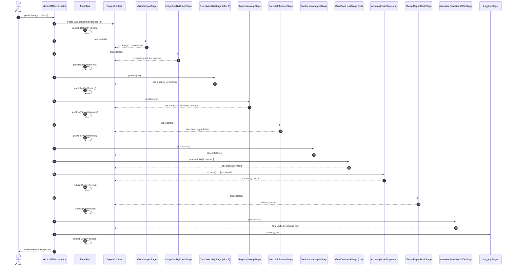
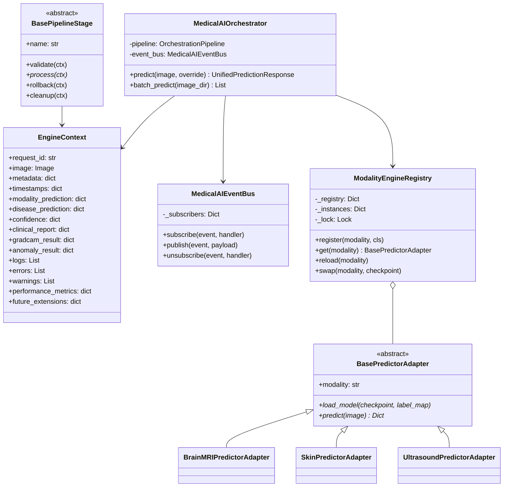
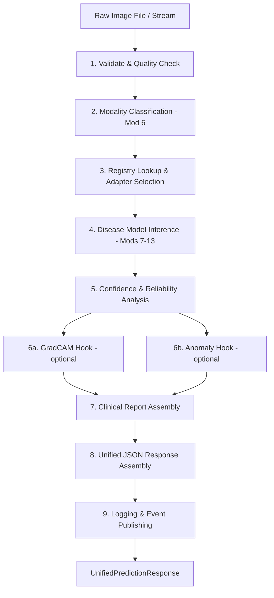

# Module 14.1: Medical AI Platform Architecture Design Specification

> **Document Version:** `2.0.0` (Refinement Update)
> **Target System Version:** `0.14.1-rev2`
> **Status:** FINAL APPROVED BLUEPRINT — Ready for Module 14.2 Implementation
> **Author:** Antigravity AI Engineering Team
> **Date:** August 1, 2026

---

## 1. Executive Summary & Vision

The **Medical AI Orchestration Engine (Module 14)** is the central intelligent routing, dispatching, prediction, and report aggregation platform for the Medical Image Diagnosis and Anomaly Detection System.

It unifies all 7 modality engines (Brain MRI, Chest X-ray, Brain CT, Histopathology, Retina, Skin, Ultrasound) into a single, cohesive, production-grade AI platform without modifying a single line of existing code in Modules 1–13.

**This document represents the final, refined architecture blueprint. Version 2.0 adds:**
- ADR-004: Prediction Lifecycle Design
- EngineContext (shared pipeline state carrier)
- PipelineStage interface contract
- Event Bus architecture
- ModelRegistry lifecycle (registration → lazy load → cache → reload → hot-swap)

---

## 2. System Overview & Platform Blueprint

```
                              Client Request
                        (Image File / PIL / Array)
                                    │
                                    ▼
              ┌─────────────────────────────────────────────┐
              │         MedicalAIOrchestrator                │
              │  (Unified Orchestration Engine Core)         │
              │                                              │
              │  ┌──────────────┐  ┌───────────────────┐    │
              │  │ SchemaValidator│  │ ImageQualityChecker│   │
              │  └──────────────┘  └───────────────────┘    │
              │          │                  │                 │
              │          └────────┬─────────┘                │
              │                   ▼                          │
              │          ┌─────────────────┐                 │
              │          │  EngineContext   │ ◄──────────────┤
              │          │  (Shared State) │                 │
              │          └─────────────────┘                 │
              │                   │                          │
              │          ┌────────▼────────┐                 │
              │          │ OrchestrationPipeline              │
              │          │ (Stage-by-Stage)│                 │
              │          └────────┬────────┘                 │
              └───────────────────┼──────────────────────────┘
                                  │
          ┌───────────────────────▼───────────────────────┐
          │               Event Bus                       │
          │  BeforePrediction → AfterPrediction           │
          │  BeforeRouting    → AfterRouting              │
          │  BeforeReport     → AfterReport               │
          └───────────────────┬───────────────────────────┘
                              │
          ┌───────────────────▼───────────────────────────┐
          │          ModelRegistry (7 Adapters)            │
          │  BrainMRI · ChestXRay · BrainCT · Histo       │
          │  Retina   · Skin      · Ultrasound             │
          └───────────────────────────────────────────────┘
```

---

## 3. Component Architecture & Layering (5 Layers)

### Layer 1: Entrance & API Gateway Layer
- **`UnifiedPredictionRequest`:** Accepts raw file paths, bytes, PIL images, or numpy arrays with optional manual modality override.
- **`SchemaValidator`:** Validates image format, color space, dimensions, and metadata integrity.
- **`ImageQualityChecker`:** Evaluates sharpness, contrast, and minimum resolution before processing.

### Layer 2: Automatic Modality Routing Layer
- **`ModalityRouter`:** Wraps Module 6 `ModalityClassifierPredictor`. Performs zero-shot modality classification when no manual override is provided.
- **Confidence Threshold:** `0.70` minimum for auto-routing. Below threshold triggers `requires_manual_review = true` but continues with top prediction.

### Layer 3: Plugin Registry & Adapter Layer
- **`ModalityEngineRegistry`:** Thread-safe singleton registry mapping modality strings to adapters.
- **`BasePredictorAdapter`:** Abstract Base Class defining standard `predict()` interface.
- **7 Modality Adapters:** `BrainMRIPredictorAdapter`, `ChestXRayPredictorAdapter`, `BrainCTPredictorAdapter`, `HistopathologyPredictorAdapter`, `RetinaPredictorAdapter`, `SkinPredictorAdapter`, `UltrasoundPredictorAdapter`.

### Layer 4: Prediction & Post-Processing Layer
- **`ReliabilityAndSeverityNormalizer`:** Maps disease-specific confidence scores, severity grades (Module 11), and reliability stages (Modules 12 & 13) to unified indicators.
- **`ClinicalReportAggregator`:** Assembles primary diagnosis, differential diagnoses, probability distribution, clinical notes, and inference latency.
- **`GradCAMHook` (Future Module 15):** Extension point for feature activation map extraction.
- **`AnomalyDetectionHook` (Future Module 16):** Extension point for out-of-distribution anomaly scoring.

### Layer 5: Output & Export Layer
- **`UnifiedPredictionResponse`:** Standardized JSON response matching Module 14 specification.
- **`ResponseLogger`:** Persists response to database/log (Future Module 19).

---

## 4. EngineContext — Shared Pipeline State Carrier

Every pipeline stage receives and modifies a single `EngineContext` object. This eliminates parameter sprawl and ensures all stages share a coherent, traceable state without tight coupling.

```python
from dataclasses import dataclass, field
from typing import Any, Dict, List, Optional
from datetime import datetime
from PIL import Image


@dataclass
class EngineContext:
    """
    Shared state carrier for the entire orchestration pipeline.
    Passed immutably by reference through every PipelineStage.
    """
    # ── Identity ──────────────────────────────────────────────────────
    request_id: str                             # UUID per request (e.g. "req_20260801_001")

    # ── Input ─────────────────────────────────────────────────────────
    image: Optional[Image.Image] = None        # PIL Image loaded at ingestion stage
    image_source: Optional[str] = None         # Original file path or URI
    manual_modality_override: Optional[str] = None  # e.g. "skin", "retina"

    # ── Metadata ──────────────────────────────────────────────────────
    metadata: Dict[str, Any] = field(default_factory=dict)  # Modality, size, format, etc.

    # ── Timing ────────────────────────────────────────────────────────
    timestamps: Dict[str, datetime] = field(default_factory=dict)
    # Expected keys:
    #   "request_received", "validation_complete", "quality_check_complete",
    #   "modality_predicted", "adapter_selected", "disease_predicted",
    #   "confidence_analysed", "gradcam_complete", "anomaly_complete",
    #   "report_complete", "logged", "response_sent"

    # ── Modality Routing ──────────────────────────────────────────────
    modality_prediction: Optional[Dict[str, Any]] = None
    # Example:
    # {
    #   "detected_modality": "skin",
    #   "modality_confidence": 0.998,
    #   "routing_mode": "automatic",  # or "manual_override"
    #   "routing_time_ms": 4.2
    # }

    # ── Disease Prediction ────────────────────────────────────────────
    disease_prediction: Optional[Dict[str, Any]] = None
    # Full output dict from the selected module adapter's predict()

    # ── Confidence Analysis ───────────────────────────────────────────
    confidence: Optional[Dict[str, Any]] = None
    # {
    #   "score": 0.9312,
    #   "reliability": "high",  # high | moderate | low
    #   "requires_manual_review": false,
    #   "severity_grade": null  # populated for retina/other graded modules
    # }

    # ── Clinical Report ───────────────────────────────────────────────
    clinical_report: Optional[Dict[str, Any]] = None
    # Assembled by ClinicalReportAggregator

    # ── GradCAM (Module 15 Extension) ────────────────────────────────
    gradcam_result: Optional[Dict[str, Any]] = None
    # {"heatmap_path": "...", "target_layer": "..."}

    # ── Anomaly Detection (Module 16 Extension) ───────────────────────
    anomaly_result: Optional[Dict[str, Any]] = None
    # {"anomaly_score": 0.12, "is_anomaly": false}

    # ── Logging Entries ───────────────────────────────────────────────
    logs: List[str] = field(default_factory=list)
    # Append-only list of structured log strings per stage

    # ── Errors & Warnings ─────────────────────────────────────────────
    errors: List[Dict[str, str]] = field(default_factory=list)
    # [{"stage": "ValidateInput", "error": "Invalid image format"}]
    warnings: List[str] = field(default_factory=list)
    # Non-fatal alerts (e.g. low modality confidence)

    # ── Performance Metrics ───────────────────────────────────────────
    performance_metrics: Dict[str, float] = field(default_factory=dict)
    # {
    #   "validation_ms": 0.5,
    #   "quality_check_ms": 1.2,
    #   "routing_ms": 4.2,
    #   "inference_ms": 11.8,
    #   "report_assembly_ms": 1.1,
    #   "total_ms": 18.8
    # }

    # ── Future Extensions (Plugin Hook Data) ──────────────────────────
    future_extensions: Dict[str, Any] = field(default_factory=dict)
    # Open namespace for Module 15, 16, 17, 18, 19+ to store custom data
    # without requiring EngineContext schema changes.
    # Example: future_extensions["module_15_xai"] = {"cam_method": "gradcam++"}
```

### EngineContext Design Rationale
- **Single-object parameter passing:** No pipeline stage signature requires more than `(self, ctx: EngineContext)`.
- **Append-only logs & errors:** Preserves full audit trail across all stages.
- **`future_extensions` namespace:** Avoids schema breakage when Modules 15–19 add data.
- **Timestamps dictionary:** Enables nanosecond-level per-stage profiling.

---

## 5. PipelineStage Interface Contract

Every orchestration stage implements `BasePipelineStage`. This enables unlimited future stages to be injected into the pipeline without modifying the engine core.

```python
from abc import ABC, abstractmethod


class BasePipelineStage(ABC):
    """
    Abstract interface for all orchestration pipeline stages.

    Lifecycle:
        process(ctx)   → Primary stage logic (mutates ctx in place)
        validate(ctx)  → Pre-condition checks before process()
        rollback(ctx)  → Undo partial mutations if process() raised
        cleanup(ctx)   → Resource teardown (file handles, GPU memory, etc.)
    """

    @property
    @abstractmethod
    def name(self) -> str:
        """Human-readable stage name for logging and diagnostics."""
        pass

    def validate(self, ctx: "EngineContext") -> None:
        """
        Pre-condition validation before process() executes.
        Raise PipelineStageValidationError on failure.
        Default: no-op (override only when pre-conditions exist).
        """
        pass

    @abstractmethod
    def process(self, ctx: "EngineContext") -> None:
        """
        Core stage logic. Mutates ctx in place.
        Must record timing in ctx.timestamps[self.name].
        Must append log entries to ctx.logs.
        Must populate ctx.errors on non-fatal failures.
        """
        pass

    def rollback(self, ctx: "EngineContext") -> None:
        """
        Undo any partial side effects if process() raised an exception.
        Default: no-op (stateless stages need not override).
        """
        pass

    def cleanup(self, ctx: "EngineContext") -> None:
        """
        Release resources held during process() (file handles, GPU tensors, etc.).
        Called in the pipeline's finally block regardless of success/failure.
        Default: no-op.
        """
        pass
```

### Defined Pipeline Stages for Module 14.2

| Order | Stage Class | Mutates Context Field |
|---|---|---|
| 1 | `ValidateInputStage` | `ctx.image`, `ctx.metadata` |
| 2 | `ImageQualityCheckStage` | `ctx.metadata["quality"]`, `ctx.warnings` |
| 3 | `DetectModalityStage` | `ctx.modality_prediction` |
| 4 | `RegistryLookupStage` | `ctx.metadata["selected_adapter"]` |
| 5 | `ExecuteInferenceStage` | `ctx.disease_prediction` |
| 6 | `ConfidenceAnalysisStage` | `ctx.confidence` |
| 7 | `GradCAMHookStage` *(optional)* | `ctx.gradcam_result`, `ctx.future_extensions` |
| 8 | `AnomalyHookStage` *(optional)* | `ctx.anomaly_result`, `ctx.future_extensions` |
| 9 | `ClinicalReportHookStage` | `ctx.clinical_report` |
| 10 | `AssemblePredictionJSONStage` | `ctx.disease_prediction["unified_response"]` |
| 11 | `LoggingStage` | `ctx.logs` |
| 12 | `ResponseStage` | Final response assembly → returned to caller |

---

## 6. ADR-004: Prediction Lifecycle Design

### Context
With 12 discrete orchestration stages, 7 pluggable disease engines, and 3+ planned extension hooks (Grad-CAM, Anomaly, Report), the pipeline needed a formally specified lifecycle to prevent coupling between stages, avoid parameter sprawl, and allow safe extension.

### Decision
All lifecycle state is carried by `EngineContext`. All stages implement `BasePipelineStage`. The orchestrator executes stages sequentially, calling `validate()` → `process()` on success, or `rollback()` + `cleanup()` on failure.

### Prediction Lifecycle — Annotated Flow

```
1. RECEIVE REQUEST
   │  Client submits image + options
   │  → EngineContext created with request_id, timestamps["request_received"]
   │
2. VALIDATE
   │  ValidateInputStage.validate() checks image format/dimensions
   │  ValidateInputStage.process() loads PIL image, populates ctx.image + ctx.metadata
   │  → Raises ImageValidationError on hard failure
   │
3. QUALITY CHECK
   │  ImageQualityCheckStage assesses sharpness, contrast, min resolution
   │  → Appends ctx.warnings if quality is below threshold
   │  → Does NOT block pipeline (soft gate only)
   │
4. PREDICT MODALITY
   │  DetectModalityStage calls ModalityRouter (wraps Module 6)
   │  → Populates ctx.modality_prediction
   │  → If confidence < 0.70, appends ctx.warnings["low_routing_confidence"]
   │
5. REGISTRY LOOKUP
   │  RegistryLookupStage queries ModalityEngineRegistry
   │  → Resolves ctx.modality_prediction["detected_modality"] → adapter instance
   │  → Raises UnsupportedModalityError if modality not registered
   │
6. DISEASE PREDICTION
   │  ExecuteInferenceStage calls adapter.predict(ctx.image)
   │  → Populates ctx.disease_prediction
   │  → Records ctx.timestamps["disease_predicted"] + ctx.performance_metrics["inference_ms"]
   │
7. CONFIDENCE ANALYSIS
   │  ConfidenceAnalysisStage normalizes prediction reliability across all module schemas
   │  → Populates ctx.confidence with score, reliability, requires_manual_review, severity_grade
   │
8. GRADCAM HOOK (Module 15 Extension — Optional)
   │  GradCAMHookStage checks if GradCAM is enabled in config
   │  → If enabled: calls feature extraction hook on adapter, stores result in ctx.gradcam_result
   │  → If disabled: no-op (stage present but skipped via ctx.future_extensions["gradcam_enabled"])
   │
9. ANOMALY HOOK (Module 16 Extension — Optional)
   │  AnomalyHookStage checks if anomaly detection is enabled
   │  → If enabled: passes ctx.disease_prediction to anomaly scorer, stores in ctx.anomaly_result
   │  → If disabled: no-op
   │
10. CLINICAL REPORT HOOK
    │  ClinicalReportHookStage assembles ctx.clinical_report from ctx.disease_prediction
    │  + ctx.confidence + ctx.modality_prediction
    │  → Calls ClinicalReportAggregator.assemble(ctx)
    │
11. PREDICTION JSON
    │  AssemblePredictionJSONStage builds UnifiedPredictionResponse from ctx
    │  → Validates schema completeness
    │  → Serializes to JSON-serializable dict
    │
12. LOGGING
    │  LoggingStage writes ctx.logs to logs/orchestration/orchestration.log
    │  → Includes request_id, modality, disease, confidence, total latency
    │  → Future Module 19 hook persists to database here
    │
13. RESPONSE
       ResponseStage returns the final UnifiedPredictionResponse to the caller
```

### Consequences
- Adding a new stage (e.g. a Telemetry stage) requires only creating a new `BasePipelineStage` subclass and inserting it into the pipeline config — no core engine changes.
- `rollback()` guarantees no partial GPU allocations persist on failure.
- `EngineContext` provides a complete audit trail for every request.

---

## 7. Event Bus Architecture

The Event Bus enables future modules (Grad-CAM, monitoring, telemetry) to subscribe to lifecycle events without modifying Module 14's core orchestration code.

```
               Orchestration Pipeline Execution
                          │
         ┌────────────────┼────────────────────┐
         │                │                    │
    BeforePrediction  BeforeRouting       BeforeReport
         │                │                    │
    [Subscribers]    [Subscribers]       [Subscribers]
    - Telemetry      - Monitoring        - Module 18
    - Logging        - Audit trail       - Database
    - Module 17      - Security          - Notification
         │                │                    │
    AfterPrediction   AfterRouting        AfterReport
```

### Event Definitions

| Event | Fired | Carries |
|---|---|---|
| `BeforePrediction` | Before ValidateInputStage | `request_id`, `image_source` |
| `AfterPrediction` | After ResponseStage completes | Full `EngineContext` |
| `BeforeRouting` | Before DetectModalityStage | `request_id`, `image` |
| `AfterRouting` | After RegistryLookupStage | `request_id`, `detected_modality`, `confidence` |
| `BeforeInference` | Before ExecuteInferenceStage | `request_id`, `adapter_name` |
| `AfterInference` | After ExecuteInferenceStage | `request_id`, `disease_prediction` |
| `BeforeReport` | Before ClinicalReportHookStage | `request_id`, `ctx.confidence` |
| `AfterReport` | After ClinicalReportHookStage | `request_id`, `clinical_report` |
| `OnError` | On any stage exception | `request_id`, `stage_name`, `error` |
| `OnLowConfidence` | When routing confidence < 0.70 | `request_id`, `modality`, `score` |

### Event Bus Interface (Design Specification)

```python
from typing import Callable, Dict, List

class MedicalAIEventBus:
    """
    Lightweight in-process publish/subscribe event bus.
    Thread-safe for concurrent request handling.
    """
    _subscribers: Dict[str, List[Callable]] = {}

    @classmethod
    def subscribe(cls, event_name: str, handler: Callable) -> None:
        """Register a handler function for a named event."""
        cls._subscribers.setdefault(event_name, []).append(handler)

    @classmethod
    def publish(cls, event_name: str, payload: dict) -> None:
        """Fire all handlers registered for event_name."""
        for handler in cls._subscribers.get(event_name, []):
            handler(payload)

    @classmethod
    def unsubscribe(cls, event_name: str, handler: Callable) -> None:
        """Remove a specific handler for an event."""
        ...
```

### Subscription Example (Module 15 subscribing without modifying Module 14)
```python
# In module 15 / gradcam/__init__.py
from orchestrator.event_bus import MedicalAIEventBus
from gradcam.hooks import attach_gradcam_hook

MedicalAIEventBus.subscribe("AfterInference", attach_gradcam_hook)
```

---

## 8. ModelRegistry Lifecycle

### Registration
Adapters register themselves at engine startup via the `ModalityEngineRegistry`:
```python
ModalityEngineRegistry.register("brain_mri", BrainMRIPredictorAdapter)
ModalityEngineRegistry.register("skin",      SkinPredictorAdapter)
# ... all 7 adapters registered
```

### Lazy Loading
Model weights are **not** loaded at registration time. The `ModelRegistry` uses lazy instantiation — adapter instances (and their underlying PyTorch model weights) are only loaded into memory when that modality is first requested.

```
REGISTRY STATE DIAGRAM

  REGISTERED (class only)
        │
        │ (first request for this modality)
        ▼
  LOADING (weights loading from disk / checkpoint)
        │
        ├── SUCCESS ──► LOADED & CACHED (ready for inference)
        │
        └── FAILURE ──► ERROR (raises ModelLoadError, logs to ctx.errors)
```

### Cache
- Each adapter instance is cached in `ModalityEngineRegistry._instances` after first load.
- Cache key: `modality_name` string (e.g. `"brain_mri"`).
- Subsequent requests for the same modality reuse the cached instance (no re-load).

### Reload
```python
ModalityEngineRegistry.reload("skin")
```
- Evicts cached instance for the given modality.
- Forces fresh load on next request (e.g. after model weight update).
- Thread-safe: uses `threading.Lock` per modality key.

### Future Hot-Swapping
```python
ModalityEngineRegistry.swap("skin", new_checkpoint_path="saved_models/skin/v2_model.pt")
```
- Loads new weights into a fresh adapter instance.
- Atomically replaces the cached instance pointer once loading succeeds.
- Zero-downtime swap: ongoing requests on the old instance complete normally.
- New requests after the swap use the new model.

### ModelRegistry Lifecycle State Machine
```
UNREGISTERED
    │  register(modality, adapter_cls)
    ▼
REGISTERED (no instance in cache)
    │  get(modality) [first call]
    ▼
LOADING
    │  load_model(checkpoint_path, label_map_path)
    ├── SUCCESS ──► CACHED (instance in _instances dict)
    │                 │  get(modality) [subsequent calls] → returns cached instance
    │                 │  reload(modality)
    │                 └──────────────────────────────────► LOADING (forced reload)
    │
    └── FAILURE ──► ERRORED (model load failed)
                      │  Raises ModelLoadError with fallback suggestion
                      └──► ONNX fallback attempt (if configured)
```

---

## 9. Software Design Patterns Reference

Full detail in: `docs/design_patterns.md`

| Pattern | Component | Purpose |
|---|---|---|
| **Registry** | `ModalityEngineRegistry` | Dynamic adapter registration & lookup |
| **Factory** | `PredictorAdapterFactory` | Adapter instantiation by modality key |
| **Strategy** | `InferenceStrategy` (`PyTorchInferenceStrategy`, `ONNXInferenceStrategy`, `TorchScriptInferenceStrategy`) | Interchangeable inference backends |
| **Pipeline** | `OrchestrationPipeline` + `BasePipelineStage` | Sequential 12-stage execution with rollback/cleanup |
| **Observer (Event Bus)** | `MedicalAIEventBus` | Decoupled lifecycle event subscription |
| **Context Object** | `EngineContext` | Single shared state carrier eliminates parameter sprawl |
| **Plugin** | Entry-point registration | Future modalities register without engine modification |
| **Null Object** | `GradCAMHookStage` / `AnomalyHookStage` | Disabled hooks are no-ops, not absent stages |

---

## 10. Unified Request & Response Schemas

Full detail in: `docs/request_response_schema.md`

### Request Schema
```json
{
  "image_source": "/path/to/image.jpg",
  "manual_modality_override": null,
  "top_k": 3,
  "inference_backend": "pytorch",
  "enable_clinical_report": true,
  "enable_gradcam": false,
  "enable_anomaly_detection": false
}
```

### Response Schema (Unified)
```json
{
  "request_id": "req_20260801_001",
  "detected_modality": "skin",
  "modality_confidence": 0.9984,
  "modality_routing_mode": "automatic",
  "prediction": {
    "module": "skin",
    "modality": "skin",
    "predicted_class": "melanoma",
    "confidence": 0.9312,
    "prediction_reliability": "high",
    "requires_manual_review": false,
    "severity_grade": null,
    "top3_predictions": [["melanoma", 0.9312], ["melanocytic_nevus", 0.041], ["basal_cell_carcinoma", 0.021]],
    "probability_distribution": { "melanoma": 0.9312, "melanocytic_nevus": 0.041 }
  },
  "clinical_report": {
    "report_type": "skin_lesion_cancer_classification",
    "primary_diagnosis": "melanoma",
    "reliability": "high",
    "requires_manual_review": false,
    "clinical_note": "HIGH RISK: Urgent dermatological evaluation and biopsy recommended."
  },
  "gradcam": null,
  "anomaly": null,
  "execution_metadata": {
    "model_version": "0.14.1",
    "routing_time_ms": 4.2,
    "inference_time_ms": 11.8,
    "total_execution_time_ms": 18.0,
    "timestamp": "2026-08-01T20:55:00Z",
    "status": "success",
    "warnings": []
  }
}
```

---

## 11. Routing Workflow

```
               [Incoming Image Input]
                        │
         Is manual_modality_override set?
                     ├── YES ──► Use Specified Modality (skip Module 6)
                     │
                     └── NO  ──► Execute Module 6 Modality Classifier
                                              │
                               Is Confidence ≥ 0.70?
                                           ├── YES ──► Route to Target Adapter
                                           │
                                           └── NO  ──► Append Low Confidence Warning
                                                        & Route to Top-1 Prediction
                                                        (requires_manual_review = true)
```

---

## 12. Error Handling & Fallback Strategy

| Failure | Handling | Response Status |
|---|---|---|
| Invalid / corrupt image | `ImageValidationError` raised immediately | `"failed"` |
| Low routing confidence (< 0.70) | Warning appended; continue with top-1 | `"warning"` |
| Unsupported modality | `UnsupportedModalityError` with supported list | `"failed"` |
| Model checkpoint missing | ONNX fallback attempted; else graceful error | `"partial"` or `"failed"` |
| Inference runtime exception | Logged; `status: "failed"` returned | `"failed"` |
| Stage rollback triggered | Cleanup called; partial ctx cleared | `"failed"` |

---

## 13. Logging Strategy

- **Log Location:** `logs/orchestration/orchestration.log`
- **Format:** `[YYYY-MM-DD HH:MM:SS] [LEVEL] [STAGE] request_id | modality | predicted_class | confidence | latency_ms`
- **Events Logged:** Request arrival, modality detection, adapter selection, inference latency, warnings, errors, response dispatch.

---

## 14. Configuration Strategy (`configs/orchestration.yaml`)

```yaml
orchestrator:
  default_backend: "pytorch"         # pytorch | onnx | torchscript
  device: "auto"                     # auto | cuda | cpu
  min_routing_confidence: 0.70
  enable_clinical_reports: true
  enable_event_bus: true
  enable_gradcam: false              # Activated by Module 15
  enable_anomaly_detection: false    # Activated by Module 16

modality_routes:
  brain_mri:
    checkpoint: "saved_models/brain_mri/best_model.pt"
    label_map: "metadata/brain_mri_label_map.json"
  chest_xray:
    checkpoint: "saved_models/chest_xray/best_model.pt"
    label_map: "metadata/chest_xray_label_map.json"
  brain_ct:
    checkpoint: "saved_models/brain_ct/best_model.pt"
    label_map: "metadata/brain_ct_label_map.json"
  histopathology:
    checkpoint: "saved_models/histopathology/best_model.pt"
    label_map: "metadata/histopathology_label_map.json"
  retina:
    checkpoint: "saved_models/retina/best_model.pt"
    label_map: "metadata/retina_label_map.json"
  skin:
    checkpoint: "saved_models/skin/best_model.pt"
    label_map: "metadata/skin_label_map.json"
  ultrasound:
    checkpoint: "saved_models/ultrasound/best_model.pt"
    label_map: "metadata/ultrasound_label_map.json"
```

---

## 15. Mermaid Sequence Diagram (Complete 12-Stage)



---

## 16. Mermaid Class Diagram



---

## 17. Mermaid Data Flow Diagram (Level 1)



---

## 18. Scalability & Performance Constraints

- **Latency Target:** ≤ 25.0 ms total end-to-end per image.
- **Concurrency:** Thread-safe registry with per-modality locks.
- **Memory:** Lazy adapter loading prevents VRAM overflow for unused modalities.
- **Hot-Swap:** Zero-downtime model update via `ModalityEngineRegistry.swap()`.

---

## 19. Extension Points for Future Modules

| Module | Extension Point |
|---|---|
| Module 15 (Grad-CAM) | Subscribe to `AfterInference` event; call `adapter.extract_features()` |
| Module 16 (Anomaly Detection) | Subscribe to `AfterInference`; anomaly scorer receives `ctx.disease_prediction` |
| Module 17 (Global Evaluation) | Subscribe to `AfterPrediction`; collect metrics |
| Module 18 (Report Generator) | Subscribe to `AfterReport`; generate full NLP report from `ctx.clinical_report` |
| Module 19 (Database) | Subscribe to `AfterPrediction`; persist `EngineContext` snapshot |
| Module 20 (Gradio UI) | Call `orchestrator.predict(pil_image)` directly |
| Module 21 (REST API) | FastAPI POST `/v1/predict` wraps `orchestrator.predict()` |

---

## 20. Architecture Decision Records

See full decisions in: `docs/architecture_decisions.md`

### ADR-001: Zero Code Mutation of Modules 1–13
**Decision:** Module 14 interacts with all existing modules via Adapter classes only. No existing source file is modified.

### ADR-002: Abstract Base Class for Engine Uniformity
**Decision:** `BasePredictorAdapter` wraps each module's predictor to provide a uniform `predict()` API.

### ADR-003: Soft Fallback for Low Routing Confidence
**Decision:** Routing confidence < 0.70 appends a warning but does not block prediction.

### ADR-004: EngineContext + PipelineStage + EventBus
**Decision:** All pipeline state carried in `EngineContext`. All stages implement `BasePipelineStage`. Lifecycle events published to `MedicalAIEventBus`. This guarantees no-coupling extensibility.

**Consequences:**
- Adding Module 15 (Grad-CAM) requires only a new `BasePipelineStage` subclass + an `EventBus` subscriber. Module 14's source code is untouched.
- `EngineContext.future_extensions` dict absorbs future data fields without schema breakage.
- `rollback()` + `cleanup()` in every stage guarantees resource safety on all code paths.

---

*Module 14.1 Architecture Design Specification — Version 2.0.0 (Final Refined Blueprint)*
