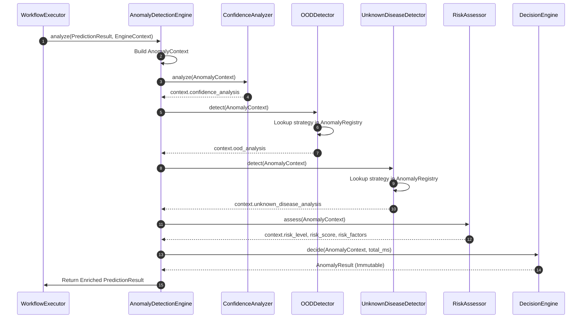
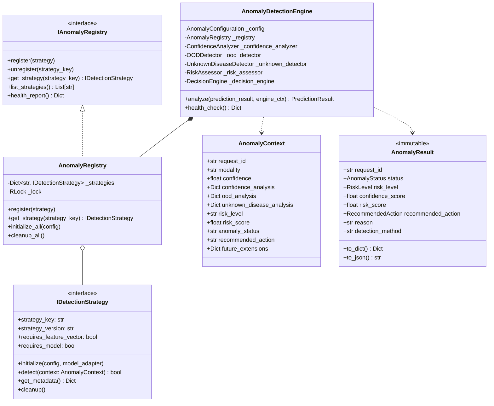

# Module 16.1 — Unknown Disease & Anomaly Detection Architecture Design

**Medical Image Diagnosis and Anomaly Detection Platform**  
**Phase 5 — Advanced AI & Anomaly Detection**  
**Status:** ✅ COMPLETE · Architecture Locked · 41/41 Architecture Tests Passed

---

## 1. Executive Summary

Module 16.1 defines the production architecture for the **Unknown Disease & Anomaly Detection Framework**. The framework sits post-prediction in the platform workflow, determining whether a model's prediction is trustworthy.

It evaluates whether an input image belongs to:
- **Known Disease:** Trusted prediction; image pattern recognized.
- **Unknown Disease:** Novel pathology pattern not present in training data.
- **Out-of-Distribution (OOD):** Input image outside model's operational domain.
- **Low-Confidence Case:** Model probability below clinical threshold.
- **Poor Quality Image:** Image quality insufficient for reliable analysis.

> 🔒 **Non-Predictive Guarantee:** The Anomaly Detection Framework does NOT perform disease classification. It only determines prediction trustworthiness and risk level.

---

## 2. Architecture Diagrams

### 2.1 Component Diagram

```mermaid
graph TD
    PR[PredictionResult] --> ADE[AnomalyDetectionEngine]
    EC[EngineContext] --> ADE

    subgraph "Anomaly Detection Framework (Module 16.1)"
        ADE --> CA[ConfidenceAnalyzer]
        ADE --> OOD[OODDetector]
        ADE --> UDD[UnknownDiseaseDetector]
        
        OOD --> AR[AnomalyRegistry]
        UDD --> AR
        
        subgraph "Detection Strategy Plugins (Module 16.2+)"
            AR --> S1["Confidence Threshold Strategy"]
            AR --> S2["Feature Distance Strategy"]
            AR --> S3["Mahalanobis Distance Strategy"]
            AR --> S4["Autoencoder Reconstruction Strategy"]
            AR --> S5["Deep SVDD Strategy"]
            AR --> S6["OpenMax Strategy"]
            AR --> S7["Energy-Based Strategy"]
        end

        CA --> RA[RiskAssessor]
        OOD --> RA
        UDD --> RA
        
        RA --> DE[DecisionEngine]
        DE --> AR_OUT[AnomalyResult (Immutable)]
    end

    AR_OUT --> PR_ENRICHED["PredictionResult.extra['anomaly_result']"]
```

### 2.2 Sequence Diagram



### 2.3 Class Diagram



### 2.4 Data Flow Diagram

```mermaid
flowchart LR
    A[Prediction Completed] --> B[PredictionResult]
    B --> C[AnomalyContext Construction]
    C --> D[Confidence Analysis]
    D --> E[OOD Strategy Detection]
    E --> F[Unknown Disease Strategy Detection]
    F --> G[Multi-Signal Risk Assessment]
    G --> H[Priority Decision Engine]
    H --> I[Immutable AnomalyResult]
    I --> J["Attach to PredictionResult.extra['anomaly_result']"]
```



---

## 3. AnomalyResult JSON Schema

```json
{
  "$schema": "https://json-schema.org/draft/2020-12/schema",
  "title": "AnomalyResult",
  "description": "Standardized output of the Medical AI Platform Anomaly Detection Framework",
  "type": "object",
  "required": [
    "request_id",
    "session_id",
    "timestamp",
    "status",
    "risk_level",
    "known_unknown_status",
    "confidence_score",
    "risk_score",
    "recommended_action",
    "reason",
    "detection_method",
    "processing_time_ms"
  ],
  "properties": {
    "request_id": { "type": "string", "format": "uuid" },
    "session_id": { "type": "string" },
    "timestamp": { "type": "string", "format": "date-time" },
    "status": {
      "type": "string",
      "enum": [
        "KNOWN_DISEASE",
        "UNKNOWN_DISEASE",
        "OUT_OF_DISTRIBUTION",
        "LOW_CONFIDENCE",
        "POOR_QUALITY",
        "NOT_ANALYZED"
      ]
    },
    "risk_level": {
      "type": "string",
      "enum": ["LOW", "MODERATE", "HIGH", "CRITICAL", "UNKNOWN"]
    },
    "known_unknown_status": {
      "type": "string",
      "enum": ["KNOWN", "UNKNOWN", "UNCERTAIN"]
    },
    "confidence_score": { "type": "number", "minimum": 0.0, "maximum": 1.0 },
    "risk_score": { "type": "number", "minimum": 0.0, "maximum": 1.0 },
    "recommended_action": {
      "type": "string",
      "enum": [
        "PROCEED",
        "MANUAL_REVIEW",
        "REPEAT_ACQUISITION",
        "ESCALATE",
        "DISCARD"
      ]
    },
    "reason": { "type": "string" },
    "detection_method": { "type": "string" },
    "processing_time_ms": { "type": "number", "minimum": 0.0 },
    "risk_factors": {
      "type": "array",
      "items": { "type": "string" }
    },
    "confidence_analysis": { "type": ["object", "null"] },
    "ood_analysis": { "type": ["object", "null"] },
    "unknown_disease_analysis": { "type": ["object", "null"] },
    "warnings": {
      "type": "array",
      "items": { "type": "string" }
    },
    "errors": {
      "type": "array",
      "items": { "type": "object" }
    },
    "metadata": { "type": "object" }
  },
  "additionalProperties": false
}
```

---

## 4. Architecture Decision Records (ADRs)

### ADR 16.1.1 — Decoupled Post-Prediction Pipeline Design
- **Context:** Anomaly detection must evaluate prediction trustworthiness without altering prediction results or requiring model changes.
- **Decision:** Position `AnomalyDetectionEngine` as a post-prediction observer. Anomaly results are attached non-destructively to `PredictionResult.extra["anomaly_result"]`.
- **Consequences:** Zero breaking changes to `MedicalAIEngine` or `EngineContext`.

### ADR 16.1.2 — Plugin-Based Detection Strategy Architecture
- **Context:** Anomaly algorithms vary significantly across modalities and clinical deployments (Autoencoders, Mahalanobis, Energy, OpenMax).
- **Decision:** Define `IDetectionStrategy` interface and `AnomalyRegistry` for dynamic strategy registration and lookup.
- **Consequences:** New detection algorithms can be added in Module 16.2+ without modifying core engine logic.

### ADR 16.1.3 — Fault-Tolerant Non-Disruptive Failure Policy
- **Context:** An anomaly detection failure must never cause a medical prediction to fail.
- **Decision:** If any anomaly stage fails, log error, record `NOT_ANALYZED` / `UNKNOWN`, and safely return the original `PredictionResult`.
- **Consequences:** Medical predictions remain available even under severe anomaly subsystem faults.

---

## 5. Verification & Test Summary

- **Architecture Unit Tests:** 41 / 41 PASSED (0.17 s)
- **Explainability Suite Regression:** 175 / 175 PASSED (6.12 s)
- **Total Combined System Tests:** 216 / 216 PASSED
